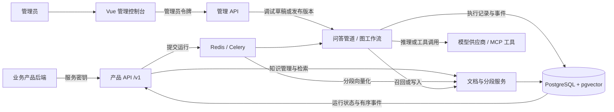

# LiteKB 架构

业务产品负责登录用户、对话界面和业务权限。LiteKB 负责存储知识、运行 Agent、追踪执行。两者通过项目级服务密钥和业务用户标识衔接。一个 LiteKB 实例可服务多个产品，同一工作区内的产品也可以拥有不同的知识库和 Agent 授权。

| 边界 | 主要源码 | 职责 |
| --- | --- | --- |
| 产品接入 | `apps/litekb_api` | 项目授权、服务密钥、知识资源、Agent、运行查询与 SSE。请求使用标准 HTTP 状态码 |
| 控制台 | `ui/src/router`、`ui/src/views`、`ui/src/workflow` | 应用与知识配置、画布、调试、运行记录、系统品牌 |
| 既有执行引擎 | `apps/application/chat_pipeline`、`apps/application/flow`、`apps/chat` | 简单问答、图调度、条件、循环、子应用、表单、MCP。调用方的资源范围会随工作流提交到线程池 |
| 持久化 | `apps/litekb_api/runs.py`、`apps/application/models`、`apps/knowledge` | Run 固定顶层发布版本，RunStep 引用聊天记录的节点结果，RunEvent 按 Run 编号。原有文档、分段与向量继续使用同一套表 |
| 部署 | `compose.yaml`、`installer/Dockerfile`、`apps/maxkb/capabilities.py` | API、Worker、PostgreSQL、Redis。媒体节点、扩展供应商及本地推理按构建选项装配 |

调试聊天沿用控制台的草稿调试权限。产品请求走已发布的 Agent，提交时固定顶层版本；系统分配会话 ID，通过客户端和用户标识隔离历史。长任务由 Worker 执行，HTTP 请求退出或 SSE 断开后，客户端可按运行 ID 查询结果。

知识库由项目显式绑定。产品可在自己的知识库内管理原件、文档与分段，Worker 在提交事务后建立索引。检索接口支持向量、关键词与混合召回。Run 回答中的 `sources` 给出检索到的知识库、文档、分段 ID，产品可用同一密钥读取分段。

部署参数和历史库迁移见[部署说明](deployment.md)。请求参数、状态和接入示例见[知识库 API](knowledge-api.md)和[运行 API](run-api.md)。

## 轻量化基线

基线为 Fork 提交 `2900bd8b`。在同一台机器上使用 Node 24.18.0、Vite 6.4.6 和同一份依赖构建。大小使用十进制 MB。静态总量累计每个发布目录的实际文件字节，入口大小统计 HTML 引用的主 JS，使用 gzip level 6。

| 指标 | 原社区版 | LiteKB 默认配置 |
| --- | ---: | ---: |
| 发布的静态文件总量 | 129,000,440 B（管理端与聊天端合计） | 28,334,112 B（控制台） |
| 管理端单独发布的静态文件 | 64,500,779 B | 28,334,112 B |
| 管理端入口 JS | 7,910,278 B | 2,338,484 B |
| 管理端入口 JS 压缩后 | 约 2.52 MB | 712,955 B |
| 默认 Python 直接依赖项 | 60 | 46（含 WSGI 启动需要的 Jinja2） |

静态发行体积下降约 78%，管理端入口压缩体积下降约 72%。操作台把调试聊天、Markdown 渲染和专用编辑器延迟到实际使用时加载。同一中文字体现只发布 WOFF2。在线工具资源保留在发行包内。

前期后端验收使用 PostgreSQL 16、pgvector 和 Redis，覆盖空库迁移、真实 Celery 消费、文档入库到已发布 Agent 引用回答、项目隔离、条件、循环与表单续跑。实际浏览器验证了登录、知识列表、品牌保存与刷新，以及 Run 的节点和最终回复。前期首轮 BuildKit 生成了 223,504,384 B（约 213 MiB）的压缩 OCI 归档，API 在就绪前退出，历史日志没有保留最终异常。已修复核心依赖和启动问题，Windows 原生 WSGI 已通过就绪探测。当前源码的 Linux Compose 部署由服务器验收。[运行恢复、检索与延迟](validation.md)
